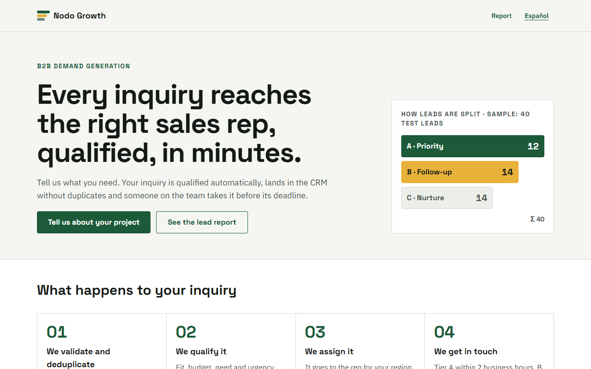
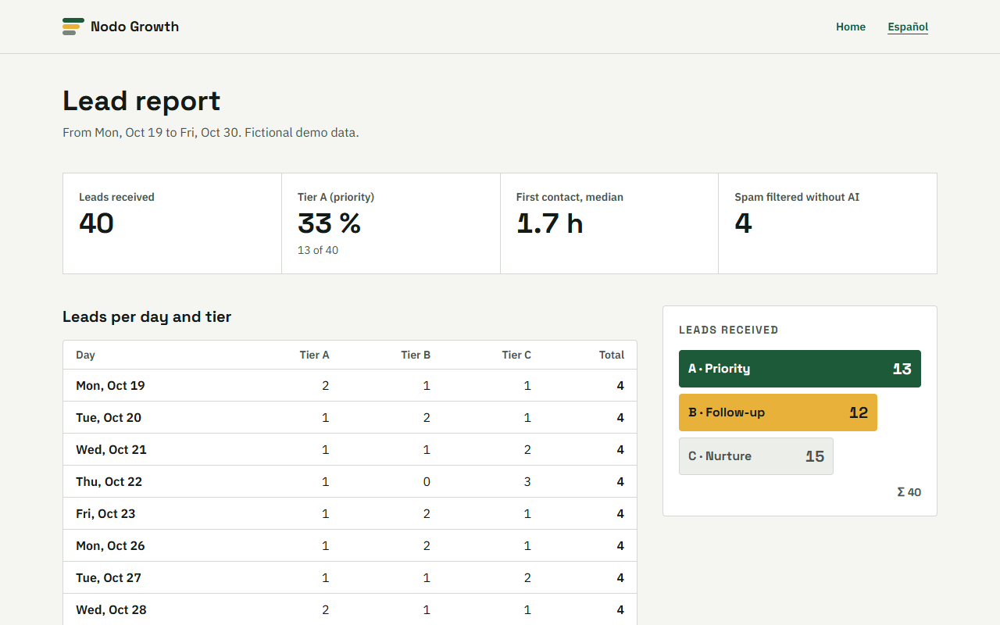
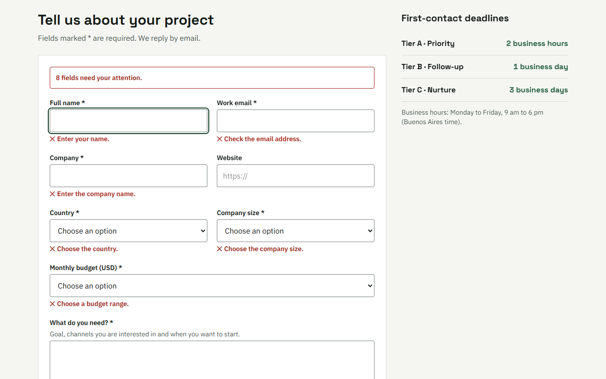
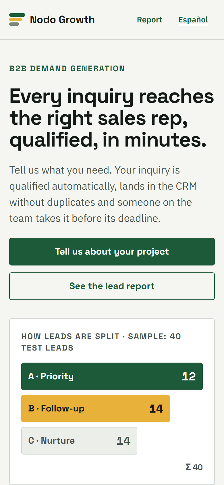
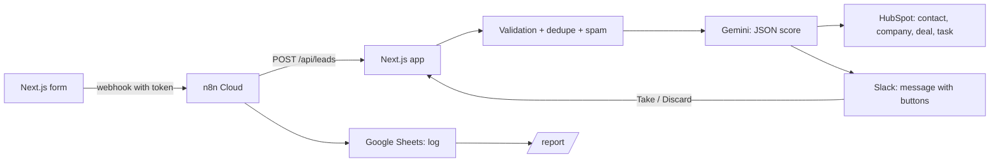

# Embudo · Lead → AI qualification → HubSpot + Slack

**Every B2B inquiry is validated, deduplicated, scored with AI and routed to the right sales rep in HubSpot and Slack,
with a task and a deadline.**

[Versión en español](README.md)

> **Demo project.** "Nodo Growth" is a fictional agency and the 40 test leads are made up (`.example.com` domains). It is
> not a real client. The site is bilingual (Spanish at `/`, English at `/en`).

## The problem

A B2B agency gets inquiries through its form and looks at them when it can: some get a late reply, others end up
duplicated in the CRM, and the sales team can't tell which ones are worth their time.

## The solution

- **Validation and deduplication:** same email = same contact (even with different casing or a `+tag`); same domain =
  same company. Obvious spam is dropped by rules, without spending an AI call.
- **AI qualification** (Gemini structured output): a 0–100 score for fit, budget, need and urgency, an A/B/C tier,
  reasons, next step and a summary. If the tier contradicts the score, the score wins.
- **HubSpot via API:** contact, company and deal (in the demo pipeline, stage by tier) created or updated without
  duplicates, plus a first-contact task due in business hours (A 2 h, B 1 day, C 3 days).
- **Rule-based owner:** large accounts (201+), Latin America or the rest of the world.
- **Slack:** A and B leads reach the channel with "Take lead" / "Discard" buttons (signature verified).
- **n8n** orchestrates: form webhook → app → log row in Google Sheets; if something fails, it alerts Slack.
- **Report** of leads by tier and by day, with the median time to first contact.

## Demo

- Live: https://embudo-topaz.vercel.app (leads go to test HubSpot and Slack accounts).
- No accounts needed: `npm run dev` and submit the form; the lead is processed in local mode and shows up in `/en/reporte`.

| | |
|---|---|
|  |  |
|  |  |

## Architecture

Decisions:
- **Ports and adapters:** the funnel talks to a `Crm` and an `Avisador` (notifier). HubSpot and Slack are one adapter
  each; tests and local mode use in-memory adapters that enforce the same uniqueness rules.
- **Fixed rules before AI:** spam, dedupe, owner, SLA and the score → tier mapping don't depend on the model.
- **No secrets in n8n:** the workflow compares the token's SHA-256 and forwards it; Sheets and Slack credentials belong
  to the account, not the workflow.

### Adapting it to Pipedrive, Zoho or GoHighLevel
Only the adapter in `src/crm/` changes (about 120 lines): find a person by email and an organization by domain, create
or update, create the deal in a pipeline and an activity with a due date. Everything else (qualification, rules,
Slack, n8n, report and tests) stays the same.

## Stack and skills

Next.js 16 · strict TypeScript · Tailwind 4 · Zod 4 · Gemini (structured output) · HubSpot CRM API v3/v4 · Slack Web
API and Block Kit · n8n · Google Sheets · Vitest · Playwright · axe · Lighthouse.

## Run it

1. `npm install` and copy `.env.example` to `.env.local` (`npm run check-env` lists what's missing without printing values).
2. `npm run dev` → http://localhost:3202 (works in local mode with no keys).
3. With test accounts: `npm run hubspot:preparar` (properties and pipeline), `npm run run-fixtures`, then
   `npm run cleanup -- --borrar` (deletes only what the demo created).
4. n8n workflow: fill in `scripts/n8n/config.json` and `npm run n8n:deploy` (created inactive until tested).

## Tests and measured results

| What was measured | Result |
|---|---|
| Tier precision vs. expected (40 leads, live Gemini) | 38/40 = 95% (end to end with live HubSpot and Slack: 38/40 and 40/40 in two runs) |
| Duplicates created in HubSpot when the 3 duplicate leads are resent | 0 |
| End-to-end time per lead, median / p95, with live HubSpot, Slack and Gemini | 5.3 s / 14.5 s |
| Same with in-memory CRM and Slack (live Gemini only) | 1.4 s / 2.3 s |
| Spam dropped without calling the AI | 4/4 |
| Unit and integration tests (Vitest) | 84/84 |
| Playwright E2E (390 px phone and 1440 px desktop) | 15/15 |
| axe WCAG 2.1 AA (5 views, 2 sizes) | 0 violations |
| Mobile Lighthouse `/` and `/reporte` (and their `/en` versions) | 98–100 / 100 / 100 / 100 |
| Run against HubSpot and Slack test accounts | _pending: published once the accounts are set up_ |

## Estimated running costs

| Item | Cost |
|---|---|
| Gemini 3.5 Flash-Lite | ~660 input and ~120 output tokens per lead → about USD 0.0005 per lead on the paid tier |
| n8n | 1 execution per lead |
| HubSpot (free), Slack (free), Google Sheets | USD 0 at this volume |

## Limits and next steps

- The run against HubSpot and Slack test accounts is pending (the code and the tests against a simulated API are done).
- `/reporte` reads the local log; in production it has to read the Google Sheet (Vercel has no persistent disk).
- The 2 remaining misses (L20 and L25) are borderline cases between B and a neighboring tier: the rubric and the model
  differ by a few points. They were left as they are, without tuning the prompt to force them.

## Author

Developed by Germán Schouabs.

## License

MIT. See [LICENSE](LICENSE).
