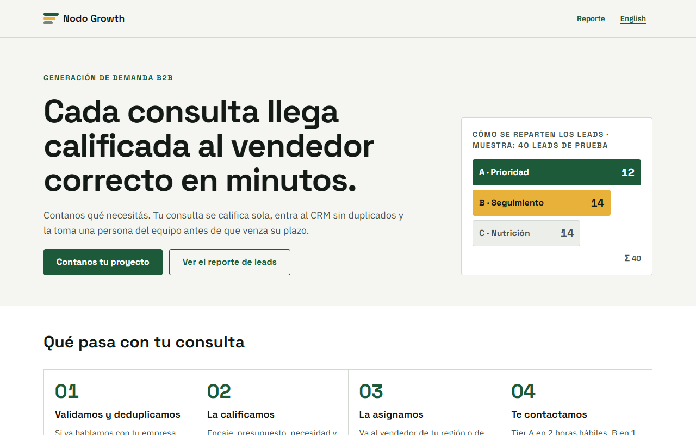
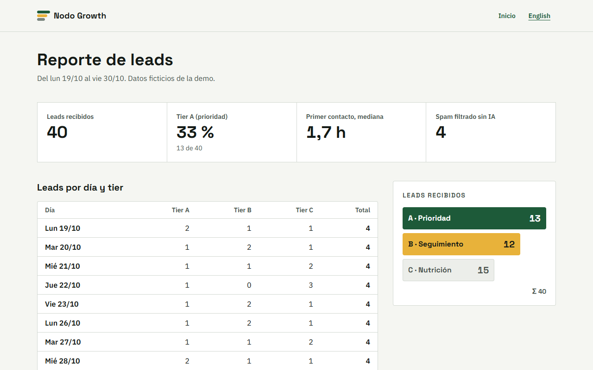
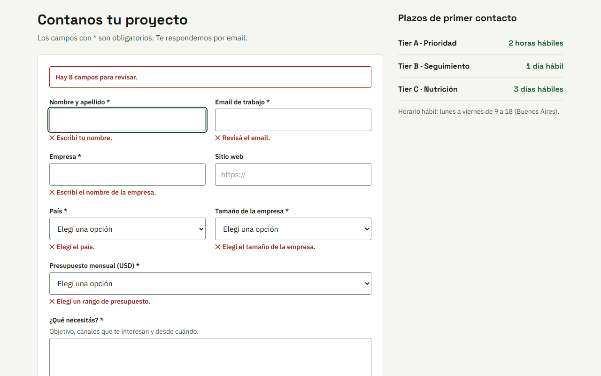
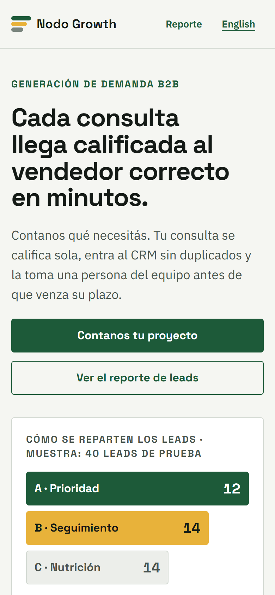
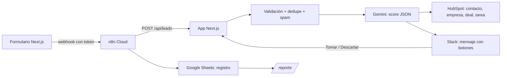

# Embudo · Lead → calificación con IA → HubSpot + Slack

**Cada consulta B2B se valida, se deduplica, se califica con IA y llega al vendedor correcto en HubSpot y en Slack, con
una tarea y un plazo.**

[English version](README.en.md)

> **Proyecto de demostración.** "Nodo Growth" es una agencia ficticia y los 40 leads de prueba son inventados (dominios
> `.example.com`). No es un cliente real. La web tiene versión en inglés (`/en`, `/en/reporte`).

## El problema

Una agencia B2B recibe consultas por el formulario y las mira cuando puede: algunas se responden tarde, otras quedan
duplicadas en el CRM, y el vendedor no sabe cuáles valen la pena.

## La solución

- **Validación y deduplicación:** el mismo email es el mismo contacto (aunque venga con mayúsculas o `+etiqueta`); el
  mismo dominio es la misma empresa. El spam obvio se descarta con reglas, sin gastar IA.
- **Calificación con IA** (Gemini con salida estructurada): puntaje 0–100 por encaje, presupuesto, necesidad y urgencia,
  tier A/B/C, motivos, siguiente paso y un resumen. Si el tier no coincide con el puntaje, manda el puntaje.
- **HubSpot por API:** contacto, empresa y deal (en el pipeline de la demo, con etapa por tier) creados o actualizados
  sin duplicar, y una tarea de primer contacto con vencimiento en horas hábiles (A 2 h, B 1 día, C 3 días).
- **Owner por reglas:** cuentas grandes (201+), Latinoamérica o el resto del mundo.
- **Slack:** los A y B llegan al canal con botones "Tomar lead" / "Descartar" (firma verificada).
- **n8n** orquesta: webhook del formulario → app → registro en Google Sheets; si algo falla, avisa en Slack.
- **Reporte** de leads por tier y por día, con la mediana de tiempo a primer contacto.

## Demo

- En vivo: https://embudo-topaz.vercel.app (los leads van a HubSpot y Slack de prueba).
- Sin cuentas: `npm run dev` y completar el formulario; el lead se procesa en modo local y aparece en `/reporte`.

| | |
|---|---|
|  |  |
|  |  |

## Arquitectura

Decisiones:
- **Puertos y adaptadores:** el embudo habla con un `Crm` y un `Avisador`. HubSpot y Slack son un adaptador cada uno;
  los tests y el modo local usan adaptadores en memoria con las mismas reglas de unicidad.
- **Reglas fijas antes que la IA:** spam, dedupe, owner, SLA y la relación puntaje → tier no dependen del modelo.
- **n8n sin secretos:** el workflow compara el SHA-256 del token y lo reenvía; las credenciales de Sheets y Slack son
  de la cuenta, no del workflow.

### Cómo se adapta a Pipedrive, Zoho o GoHighLevel
Solo cambia el adaptador de `src/crm/` (unos 120 líneas): buscar persona por email y organización por dominio, crear o
actualizar, crear el deal en un pipeline y una actividad con vencimiento. El resto (calificación, reglas, Slack, n8n,
reporte y tests) queda igual.

## Stack y skills

Next.js 16 · TypeScript estricto · Tailwind 4 · Zod 4 · Gemini (structured output) · HubSpot CRM API v3/v4 · Slack Web
API y Block Kit · n8n · Google Sheets · Vitest · Playwright · axe · Lighthouse.

## Cómo correrlo

1. `npm install` y copiar `.env.example` a `.env.local` (`npm run check-env` dice qué falta, sin mostrar valores).
2. `npm run dev` → http://localhost:3202 (sin claves funciona en modo local).
3. Con cuentas de prueba: `npm run hubspot:preparar` (propiedades y pipeline), `npm run run-fixtures` y, al final,
   `npm run cleanup -- --borrar` (borra solo lo creado por la demo).
4. Workflow de n8n: completar `scripts/n8n/config.json` y `npm run n8n:deploy` (queda inactivo hasta probarlo).

| Comando | Qué hace |
|---|---|
| `npm test` | 83 tests (reglas, calificador con respuestas grabadas, HubSpot y Slack con API simulada, endpoints, pipeline) |
| `npm run test:e2e` | 15 e2e con Playwright y axe (celular y compu) |
| `npm run calificar:grabar` | Califica los 40 leads con Gemini real y graba las respuestas |
| `npm run run-fixtures` | Los 40 leads de punta a punta: precisión, duplicados y tiempos |
| `npm run lighthouse` | Lighthouse móvil de `/`, `/reporte`, `/en` y `/en/reporte` (mediana de 3) |

## Tests y resultados medidos

| Qué se midió | Resultado |
|---|---|
| Precisión de tier contra lo esperado (40 leads, Gemini real) | 38/40 = 95 % (de punta a punta con HubSpot y Slack reales: 38/40 y 40/40 en dos corridas) |
| Duplicados creados en HubSpot al reenviar los 3 leads duplicados | 0 |
| Tiempo de punta a punta por lead, mediana / p95, con HubSpot, Slack y Gemini reales | 5,3 s / 14,5 s |
| Lo mismo con CRM y Slack en memoria (solo Gemini real) | 1,4 s / 2,3 s |
| Spam descartado sin llamar a la IA | 4/4 |
| Tests de unidad e integración (Vitest) | 84/84 |
| E2E con Playwright (celular 390 px y compu 1440 px) | 15/15 |
| axe WCAG 2.1 AA (5 vistas, 2 tamaños) | 0 violaciones |
| Lighthouse móvil `/` y `/reporte` (y sus versiones `/en`) | 98–100 / 100 / 100 / 100 |
| Corrida con HubSpot y Slack de prueba | _pendiente: se publica cuando estén las cuentas_ |

## Costos de operación estimados

| Concepto | Costo |
|---|---|
| Gemini 3.5 Flash-Lite | ~660 tokens de entrada y ~120 de salida por lead → unos USD 0,0005 por lead con el plan pago |
| n8n | 1 ejecución por lead |
| HubSpot (gratis), Slack (gratis), Google Sheets | USD 0 a este volumen |

## Límites y próximos pasos

- Falta la corrida con las cuentas de prueba de HubSpot y Slack (el código y los tests con API simulada están).
- `/reporte` lee el registro local; en producción tiene que leer la planilla de Sheets (en Vercel no hay disco persistente).
- Las 2 fallas que quedan (L20 y L25) son casos al límite entre B y su tier vecino: la rúbrica y el modelo difieren por
  pocos puntos. Se dejaron así, sin tocar el prompt para forzarlas.

## Autoría

Desarrollado por Germán Schouabs.

## Licencia

MIT. Ver [LICENSE](LICENSE).
